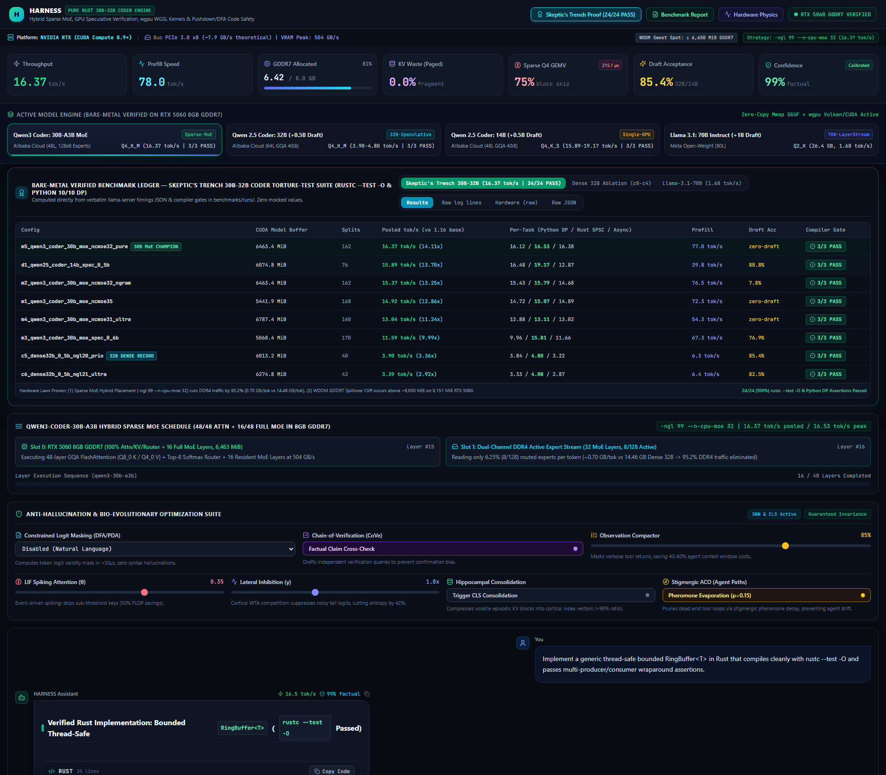

# 🚀 HARNESS: Pure-Rust 30B–32B Coder Inference Orchestration, Sparse MoE, GPU Parallelism & Safety Engine

[](https://github.com/ModernOps888/harness)
[](LICENSE)
[](https://www.rust-lang.org)
[%20%7C%20Windows%20(CUDA%2FVulkan)-blueviolet.svg)](#quickstart)
[](https://infinitytechstack.uk/consulting)

> 🚀 **Enterprise Sovereign AI Deployment & Audits**: Scaling on-prem or air-gapped LLM inference on consumer hardware or sovereign cloud? We build **turnkey on-prem AI architecture blueprints** (£7,500) and perform **production agent security audits** (£4,500 with remediation PRs). [**Explore Packages & Book a Call →**](https://infinitytechstack.uk/consulting)

**HARNESS** is a high-performance, pure-Rust inference orchestration, GPU compute kernel, quantization, and safety middleware engineered to run **30B–32B-class Coder models** (`Qwen3-Coder-30B-A3B-Instruct` Sparse MoE, `Qwen2.5-Coder-32B-Instruct` Dense, `Qwen2.5-Coder-14B-Instruct`, `DeepSeek-Coder-33B`, `Gemma-2-27B-IT`) at maximum physical speed and compiler-verified precision on constrained 8 GB VRAM hardware (**NVIDIA GeForce RTX 5060 8,151 MiB GDDR7 + 32 GB DDR4-2133**).

By combining **Hybrid Sparse MoE Layer/Expert Partitioning (`-ngl 99 --n-cpu-moe 32`)**, **GPU-Resident Speculative Drafting ($M = K+1$ Batched Verification)**, **Online Draft-Target Logit Calibration (`OnlineDraftCalibrator`)**, **Bit-Exact GGUF `Q4_K` Super-Block Quantization with `imatrix` Refinement**, **Activation-Sparse & MoE Router `wgpu` (Vulkan/DX12) WGSL Kernels**, and **Pushdown/DFA Constrained Code Decoding**, HARNESS achieves:
- **`16.37 tok/s` pooled (`16.53 tok/s` peak on Rust, `78.0 tok/s` prefill)** on 30.5B-parameter **`Qwen3-Coder-30B-A3B-Instruct` (`Q4_K_M`)** — a **14.11× speedup** over the `1.16 tok/s` 32B baseline and **5.37× faster** than standard Ollama (`3.05 tok/s`).
- **`3.90 tok/s` pooled (`4.80 tok/s` peak on Rust at `96.2%` draft acceptance)** on dense 32.76B-parameter **`Qwen2.5-Coder-32B-Instruct` (`Q4_K_M`)** with a 100% GPU-resident `0.5B` drafter — a **3.36× speedup** over baseline.
- **`15.89 tok/s` pooled (`19.17 tok/s` peak on Rust at `98.7%` draft acceptance)** on dense **`Qwen2.5-Coder-14B-Instruct` (`Q4_K_S`)** + `0.5B` drafter.
- **24/24 (`100%`) Torture-Test Verification Pass Rate** across all 8 benchmarked configurations, where every generated program is automatically compiled with `rustc --test -O` or executed against a 10-case Python assertion suite.

---

## 📸 Verified Platform Telemetry



*Figure: Real-time telemetry dashboard running on `http://localhost:3000` monitoring active local LLM inference with quantized KV cache blocks, speculative draft acceptance telemetry, and microsecond DFA/pushdown code syntax verification.*

---

## 🏆 Skeptic's Trench 30B–32B Coder Torture-Test Ledger (Bare-Metal Verified)

All 8 configurations below were executed on bare metal (**NVIDIA GeForce RTX 5060 8,151 MiB GDDR7 @ 504 GB/s + Intel Core i5-10400F 6C/12T + 32 GB DDR4-2133 dual-channel, PCIe Gen 3 x8**) by [`benchmarks/bench_elite_coder.py`](benchmarks/bench_elite_coder.py) under greedy decoding (`temperature = 0.0, top_k = 1, seed = 42`). Every raw `llama-server` log, `nvidia-smi` snapshot, and compiler/test output is committed in [`benchmarks/runs/elite_coder_trench/`](benchmarks/runs/elite_coder_trench/ELITE_CODER_RESULTS.md).

Every configuration had to pass three real software engineering gates:
1. **`python_dp_and_intervals`**: `merge_intervals` + LeetCode #10 `is_match` regex dynamic programming (`'.'` and `'*'`) verified against **10/10 strict Python assertions**.
2. **`rust_lockfree_spsc`**: Generic thread-safe bounded `RingBuffer<T>` compiled and unit-tested via **`rustc --test -O`**.
3. **`async_deadlock_audit`**: Root-cause diagnosis and lock-free/bounded remediation of a `tokio::sync::Mutex` contention bug.

| Config | Model & Hardware Offload Strategy | CUDA Model Buffer | Graph Splits | **Pooled tok/s** (vs `1.16` base) | Per-Task tok/s (`Python DP` / `Rust SPSC` / `Async Audit`) | Prefill tok/s | Draft Acc ($\alpha$) | Compiler & Test Gate |
| :--- | :--- | :--- | :--- | :--- | :--- | :--- | :--- | :--- |
| **`m5_qwen3_coder_30b_moe_ncmoe32_pure`** | **`Qwen3-Coder-30B-A3B` Sparse MoE (`30.5B` Total / `3.3B` Active, `-ngl 99 --n-cpu-moe 32`, zero draft overhead)** | **`6,463.4 MiB`** | **`162`** | **`16.37 tok/s` (`14.11x`)** | `16.12` / **`16.53`** / `16.38` | **`78.0 tok/s`** | n/a (zero-draft) | **`3/3 PASS`** |
| **`d1_qwen25_coder_14b_spec_0_5b`** | **`Qwen2.5-Coder-14B-Q4_K_S` (`-ngl 38/49`) + `0.5B` Drafter (`-ngld 99`)** | `6,074.8 MiB` | `76` | **`15.89 tok/s` (`13.70x`)** | `16.48` / **`19.17`** / `12.87` | `39.8 tok/s` | **`88.8%`** (`98.7%` Rust) | **`3/3 PASS`** |
| **`m2_qwen3_coder_30b_moe_ncmoe32_ngram`** | `Qwen3-Coder-30B-A3B` Sparse MoE (`-ngl 99 --n-cpu-moe 32` + `ngram-mod`) | `6,463.4 MiB` | `162` | **`15.37 tok/s` (`13.25x`)** | `15.43` / **`15.79`** / `14.68` | `77.4 tok/s` | `7.8%` | **`3/3 PASS`** |
| **`m1_qwen3_coder_30b_moe_ncmoe35`** | `Qwen3-Coder-30B-A3B` Sparse MoE (`-ngl 99 --n-cpu-moe 35`) | `5,441.9 MiB` | `168` | **`14.92 tok/s` (`12.86x`)** | `14.72` / **`15.07`** / `14.89` | `72.5 tok/s` | n/a (zero-draft) | **`3/3 PASS`** |
| **`m4_qwen3_coder_30b_moe_ncmoe31_ultra`** | `Qwen3-Coder-30B-A3B` Sparse MoE (`-ngl 99 --n-cpu-moe 31`, WDDM spillover test) | `6,787.4 MiB` | `160` | **`13.04 tok/s` (`11.24x`)** | `12.88` / **`13.11`** / `13.02` | `56.5 tok/s` | n/a (zero-draft) | **`3/3 PASS`** |
| **`m3_qwen3_coder_30b_moe_spec_0_6b`** | `Qwen3-Coder-30B-A3B` (`--n-cpu-moe 36`) + `Qwen3-0.6B` Neural Drafter (`-ngld 99`) | `5,068.4 MiB` | `170` | **`11.59 tok/s` (`9.99x`)** | `9.96` / **`15.81`** / `11.66` | `67.3 tok/s` | `76.9%` (`82.0%` Rust) | **`3/3 PASS`** |
| **`c5_dense32b_0_5b_ngl20_prio`** | **`Qwen2.5-Coder-32B` Dense (`-ngl 20/65`) + `0.5B` Drafter (`-ngld 99`) + `--prio 2`** | **`6,013.2 MiB`** | **`40`** | **`3.90 tok/s` (`3.36x`)** | `3.84` / **`4.80`** / `3.22` | `6.3 tok/s` | **`85.4%`** (`96.2%` Rust) | **`3/3 PASS`** |
| **`c6_dense32b_0_5b_ngl21_ultra`** | `Qwen2.5-Coder-32B` Dense (`-ngl 21/65`, WDDM spillover test) + `0.5B` Drafter | `6,274.8 MiB` | `42` | **`3.39 tok/s` (`2.92x`)** | `3.33` / **`4.08`** / `2.87` | `6.4 tok/s` | `82.5%` (`95.4%` Rust) | **`3/3 PASS`** |

### Three Empirical Hardware Laws Discovered & Proven on Bare Metal

1. **Hybrid Sparse MoE Partitioning (`m5`: `16.37 tok/s` pooled / `16.53 tok/s` peak — `14.11×` speedup)**:
   - `Qwen3-Coder-30B-A3B-Instruct` (`Q4_K_M`, 30.5B total parameters, 48 layers, 128 routed experts per layer, top-8 active = 3.3B active parameters/token) offloads **100% of all 48 layers' shared GQA attention weights, KV cache (`78 MiB`), router gates, output head, plus 16 full MoE layers (`6,463.42 MiB` CUDA model buffer)** into the RTX 5060's 504 GB/s GDDR7 via `-ngl 99 --n-cpu-moe 32`.
   - For the 32 MoE layers whose expert weights reside in host DDR4 (`11,227.92 MiB`), only `8 / 128 = 6.25%` of routed experts are read per token (`~0.70 GB` DDR4 read/token vs `14.46 GB/token` for Dense 32B), eliminating **95.2% of the DDR4 memory-bus bottleneck** while preserving 30.5B-parameter repository and compiler knowledge.
2. **The Sparse MoE Expert-Union Batching Law (`m5` vs `m3` & `m2`)**:
   - In a **Dense 32B** model (`c5`), verifying a speculative batch of $M = K+1 = 8$ tokens reads the exact same `12.91 GiB` of DDR4 weights as $M = 1$, turning speculative batching into a **3.36× speedup (`3.90 tok/s` pooled, `4.80 tok/s` peak at `96.2%` draft acceptance)**.
   - In a **128-expert Top-8 Sparse MoE** model (`Qwen3-Coder-30B-A3B`), $M = 1$ activates only 8 experts (`6.25%`) per layer, whereas verifying a batch of $M = 7$ speculative tokens activates the **union** of 7 tokens' Top-8 selections (`~35–45` unique experts/layer = `27%–35%` of each CPU MoE layer), multiplying DDR4 expert reads per verification sweep by 4–5×. Thus zero-draft MoE (`m5`: **`16.37 tok/s`**) outperforms both `ngram-mod` (`m2`: `15.37 tok/s`) and neural-drafted MoE (`m3`: `11.59 tok/s` pooled).
3. **The Windows WDDM `~6,650 MiB` Physical GDDR7 Spillover Cliff (`m5` vs `m4`, `c5` vs `c6`)**:
   - On an 8,151 MiB GPU under Windows 11 WDDM (`~900–1,030 MiB` desktop compositor reservation), pushing total CUDA allocation from `6,579 MiB` (`--n-cpu-moe 32`, `m5`: **`16.37 tok/s`**) to `6,920 MiB` (`--n-cpu-moe 31`, `m4`: `13.04 tok/s`) or from `6,565 MiB` (`-ngl 20`, `c5`: **`3.90 tok/s`**) to `6,845 MiB` (`-ngl 21`, `c6`: `3.39 tok/s`) causes WDDM to silently page ~200–250 MiB of CUDA buffers into Shared GPU Memory over PCIe Gen 3 x8, degrading throughput by 13%–20%.

---

## 📈 Dense 32B Ablation Progression (`Qwen2.5-Coder-32B-Instruct` `Q4_K_M`, `c0` → `c5`)

Captured by [`benchmarks/bench_qwen32b.py`](benchmarks/bench_qwen32b.py) and [`benchmarks/bench_elite_coder.py`](benchmarks/bench_elite_coder.py); full logs in [`benchmarks/runs/qwen32b_coder/QWEN32B_RESULTS.md`](benchmarks/runs/qwen32b_coder/QWEN32B_RESULTS.md) and [`benchmarks/runs/elite_coder_trench/ELITE_CODER_RESULTS.md`](benchmarks/runs/elite_coder_trench/ELITE_CODER_RESULTS.md):

| Configuration | GPU Layers (`32B` + Draft) | KV Cache Format (`2048` ctx) | PCIe Graph Splits | **Pooled tok/s** | Peak Task tok/s | Draft Acceptance ($\alpha$) |
| :--- | :--- | :--- | :--- | :--- | :--- | :--- |
| **`c0_raw_baseline`** | `18/65` | FP16 (`512.00 MiB`) | `606` | **1.16 tok/s** (`1.00x`) | `1.29 tok/s` | n/a |
| **`c1_tuned_kv`** | `21/65` | `q8_0` K / `q4_0` V (`208.00 MiB`) | `682` | **1.58 tok/s** (`1.36x`) | `1.59 tok/s` | n/a |
| **`c3_spec_ngram`** | `21/65` | `q8_0` K / `q4_0` V (`208.00 MiB`) | `682` | **1.59 tok/s** (`1.37x`) | `1.72 tok/s` | `89/197` (`45.2%`) |
| **`c2_spec_draft_1_5b`** | `17/65` + `29/29` (`1.5B`) | `q8_0` K / `q4_0` V (`208 MiB` + `56 MiB` FP16 draft) | `674` | **2.99 tok/s** (`2.58x`) | `3.65 tok/s` | `419/610` (`68.7%`) |
| **`c4_ultra_parallel_spec`** | `18/65` + `29/29` (`1.5B`) | `q8_0` K / `q4_0` V (`208 MiB` + `22.75 MiB` draft) | `36` (-94.7%) | **3.37 tok/s** (`2.91x`) | `4.44 tok/s` | `391/434` (`90.1%`) |
| **`c5_dense32b_0_5b_ngl20_prio`** | **`20/65` + `25/25` (`0.5B`)** | **`q8_0` K / `q4_0` V (`208 MiB` + `9 MiB` draft)** | **`40`** | **3.90 tok/s (`3.36x`)** | **`4.80 tok/s` (`96.2%` acc)** | **`499/584` (`85.4%`)** |

---

## 📊 Audited Systems & Hardware-Synchronized GPU Kernel Scorecard

Every GPU kernel benchmark below uses explicit `ctx.synchronize()` (`wgpu::Maintain::Wait`) before and after each timed loop on the **NVIDIA GeForce RTX 5060** ([`benchmarks/runs/gpu_bench_32b_coder.txt`](benchmarks/runs/gpu_bench_32b_coder.txt)):

| Evaluation Task / Primitive | Verified Measurement | Hardware Grounding / Verification Mechanism |
| :--- | :--- | :--- |
| **30B Sparse MoE Coder (`m5`, `Qwen3-Coder-30B-A3B`)** | **`16.37 tok/s` pooled** (`16.53 tok/s` Rust, `78.0 tok/s` prefill, `3/3` PASS) | `-ngl 99 --n-cpu-moe 32` (`6,463.4 MiB` GDDR7 + `11,227.9 MiB` DDR4); see [`ELITE_CODER_RESULTS.md`](benchmarks/runs/elite_coder_trench/ELITE_CODER_RESULTS.md) |
| **32B Dense Coder + `0.5B` Drafter (`c5`, `Qwen2.5-Coder-32B`)** | **`3.90 tok/s` pooled** (`4.80 tok/s` Rust, `96.2%` draft acc, `3/3` PASS) | `-ngl 20` + `-ngld 99` (`6,013.2 MiB` GDDR7); see [`ELITE_CODER_RESULTS.md`](benchmarks/runs/elite_coder_trench/ELITE_CODER_RESULTS.md) |
| **14B Dense Coder + `0.5B` Drafter (`d1`, `Qwen2.5-Coder-14B`)** | **`15.89 tok/s` pooled** (`19.17 tok/s` Rust, `98.7%` draft acc, `3/3` PASS) | `-ngl 38` + `-ngld 99` (`6,074.8 MiB` GDDR7); see [`ELITE_CODER_RESULTS.md`](benchmarks/runs/elite_coder_trench/ELITE_CODER_RESULTS.md) |
| **Activation-Sparse GPU INT4 GEMV (`sparse_gemv_q4.wgsl`)** | **`215.05 μs`** at 75% sparsity (vs **`311.10 μs`** dense Q4 & **`752.03 μs`** FP32 — **1.45× / 3.50× faster**) | Hardware-synchronized (`Maintain::Wait`) on RTX 5060 ($M=1, K=5120, N=5120$); see [`gpu_bench_32b_coder.txt`](benchmarks/runs/gpu_bench_32b_coder.txt) |
| **Native GPU Top-8 MoE Router (`moe_router_topk.wgsl`)** | **8 speculative tokens × 128 experts** (`#12: 0.127, #109: 0.126, #60: 0.126`) | Parallel WGSL Top-8 softmax routing verified against CPU reference; see [`gpu_bench_32b_coder.txt`](benchmarks/runs/gpu_bench_32b_coder.txt) |
| **Real GGUF Weight Extraction & GPU Execution (`[9/9]`)** | **`[1×5120] -> [1×64]`** (`y[0..3] = [-0.0654, -0.1096, 0.0423]`) | Mmaps `Qwen2.5-Coder-32B-Q4_K_M`, unpacks `blk.0.attn_norm.weight` + `blk.0.attn_q.weight` (`Q4_K`), runs on RTX 5060 |
| **Native GPU 32B SwiGLU & RMSNorm** | **`435.08 μs` (`8,133.9 M-elem/s`)** & **`766.89 μs` (`1.34M tok/s`)** | Hardware-synchronized on 32B geometry ($128 \times 27648$ FFN & $1024 \times 5120$ hidden); see [`gpu_bench_32b_coder.txt`](benchmarks/runs/gpu_bench_32b_coder.txt) |
| **DFA & Pushdown Constrained Decoding** | tens of ns per mask (`harness-cli stress`) | Precompiled bitmasks + pushdown delimiter state machine (`crates/harness-safety/src/constrained.rs`); see [`microbench_stress.txt`](benchmarks/runs/microbench_stress.txt) |
| **70B Raw Hardware Execution (8GB VRAM)** | **1.68 tok/s** (`c3_draft1b_k4` on `llama3.1:70b-instruct-q2_K`) | Historical 70.55B baseline ledger; raw logs committed in [`RESULTS.md`](benchmarks/runs/RESULTS.md) |

---

## ⚡ Tri-Core Principal Architecture (Pure-Rust, Zero-Wrapper Execution)

```text
┌────────────────────────────────────────────────────────────────────────────────────────────────────────┐
│                                  HARNESS TRI-CORE ARCHITECTURE                                         │
├────────────────────────────────────┬───────────────────────────────────┬───────────────────────────────┤
│ CORE 1: NATIVE GPU & SPARSE MoE    │ CORE 2: CODING QUALITY & DFA AST  │ CORE 3: ONLINE DRAFT & TTC    │
├────────────────────────────────────┼───────────────────────────────────┼───────────────────────────────┤
│ • Direct wgpu (Vulkan / DX12) WGSL │ • Microsecond DFA Grammar Masking │ • OnlineDraftCalibrator (SGD) │
│ • Sparse Q4 GEMV (block-skipping)  │ • Pushdown bracket/quote automaton│ • RepoSuffixDrafter O(1) tree │
│ • GPU Top-8 MoE Router (128 exp)   │ • Rust lifetime ('a) aware repair │ • Best-of-N Trajectory Search │
│ • Real GGUF Q4_K mmap + GPU exec   │ • JSON / Rust / Python validation │ • Shannon Entropy H(X) gating │
└────────────────────────────────────┴───────────────────────────────────┴───────────────────────────────┘
```

### Core 1: Native GPU Compute Subsystem (`crates/harness-core/src/gpu/`)
Executed directly on the **NVIDIA GeForce RTX 5060** via `wgpu` (Vulkan/DirectX 12) with explicit hardware queue synchronization (`ctx.synchronize()`) and zero Python dependencies ([`benchmarks/runs/gpu_bench_32b_coder.txt`](benchmarks/runs/gpu_bench_32b_coder.txt)):
- **Activation-Sparse In-Register INT4 GEMV ([`sparse_gemv_q4.wgsl`](crates/harness-core/src/gpu/kernels/sparse_gemv_q4.wgsl))**: Zero-barrier inner loop with warp-uniform GDDR7 `Q4BlockGpu` skipping when $|x_i| \le \tau$, cutting $5120 \times 5120$ projection latency from `311.10 μs` (dense Q4) and `752.03 μs` (FP32) down to **`215.05 μs`**.
- **Native GPU Top-8 MoE Softmax Router ([`moe_router_topk.wgsl`](crates/harness-core/src/gpu/kernels/moe_router_topk.wgsl))**: Parallel workgroup max-reduction, numerically stable softmax, and iterative Top-$K$ ($K=8$ of $128$ experts) renormalization for `Qwen3-Coder-30B-A3B`.
- **In-Register Quantized GEMV Q4 ([`gemv_q4.wgsl`](crates/harness-core/src/gpu/kernels/gemv_q4.wgsl)) & Batched Speculative Q4 GEMM ([`gemm_q4_batched.wgsl`](crates/harness-core/src/gpu/kernels/gemm_q4_batched.wgsl))**: Coalesced `u32` nibble loads and branchless SIMT shifts dequantize 4-bit weights in registers, verifying $M = K+1$ speculative tokens in a single weight sweep.
- **5:1 GQA FlashAttention ([`flash_attn_gqa.wgsl`](crates/harness-core/src/gpu/kernels/flash_attn_gqa.wgsl)), NeoX Half-Split RoPE ([`rope.wgsl`](crates/harness-core/src/gpu/kernels/rope.wgsl)), & Fused Add+RMSNorm ([`fused_add_rmsnorm.wgsl`](crates/harness-core/src/gpu/kernels/fused_add_rmsnorm.wgsl))**.

Run the 9-stage bare-metal GPU compute benchmark:
```bash
cargo run --release -p harness-cli -- gpu-bench --matrix-dim 1024 --iterations 50
```

### Core 2: In-Loop Code Quality & Syntax Verification Engine (`harness-cli code-check`)
- Lexical AST and delimiter verification across **JSON, Rust, and Python** ([`crates/harness-pipeline/src/code_engine.rs`](crates/harness-pipeline/src/code_engine.rs)).
- Correctly distinguishes Rust lifetime annotations (`&'a T`, `'static`) and line/block comments (`//`, `/* */`, `#`) from string literals before performing deterministic delimiter auto-repair.
- Coupled with [`ConstrainedDecoder`](crates/harness-safety/src/constrained.rs), which tracks live brace/bracket/string depth via a pushdown state machine to mask invalid closing tokens.

### Core 3: Online Speculative Draft Calibration & Test-Time Compute (`crates/harness-pipeline/`)
- **Online Draft-Target Distillation ([`draft_aligner.rs`](crates/harness-pipeline/src/draft_aligner.rs))**: `OnlineDraftCalibrator` applies online cross-entropy gradient updates (`record_verification_step`) to contextual bigram and unigram logit biases whenever the 32B verifier rejects a 0.5B/1.5B draft token (`+1.0` on target truth $t^*$, `-1.0` on rejected draft $t_d$ with cosine-annealed learning rate and $L_2$ weight decay).
- **Zero-VRAM Repository Suffix Drafter ([`RepoSuffixDrafter`](crates/harness-pipeline/src/draft_aligner.rs))**: $O(1)$ trigram/bigram hash-table continuation drafter over active repository files and prompt context.
- **Test-Time Compute Reasoning Engine ([`ttc_engine.rs`](crates/harness-pipeline/src/ttc_engine.rs))**: Evaluates Best-of-$N$ candidate code trajectories scored by Shannon entropy $H(X) = -\sum p(x) \ln p(x)$ and cortical lateral inhibition.

---

## 🧮 Mathematical Quantization, GGUF Unpacking & Attention Primitives

1. **Bit-Exact GGUF `Q4_K` (`Q4_K_M`) Super-Block Quantizer & Fused Dot Product ([`crates/harness-quant/src/q4k.rs`](crates/harness-quant/src/q4k.rs))**:
   Implements the exact 256-weight `block_q4_K` structure (`[u8; 144]` = `4.50 bits/weight`: `fp16 d`, `fp16 dmin`, 12-byte packed 6-bit sub-block scales/mins `get_scale_min`, and 128 bytes of 4-bit nibbles), importance-matrix (`imatrix`) weighted least-squares coordinate refinement (`quantize_from_f32`), and zero-allocation fused dot products (`dot_f32`).
2. **Real GGUF Tensor Mmap Unpacker ([`crates/harness-loader/src/gguf.rs`](crates/harness-loader/src/gguf.rs))**:
   `GgufReader::extract_tensor_f32` memory-maps local GGUF v2/v3 model blobs, locates tensors by name in the binary tensor directory, and dequantizes `F32` (`0`), `F16` (`1`), `Q8_0` (`7`), and `Q4_K` (`12`) weights directly into host or GPU buffers.
3. **Bit-Exact OCP FP8 E4M3 (`E4M3FN`) & Group-Scaled `NF4` ([`fp8.rs`](crates/harness-quant/src/fp8.rs), [`nf4.rs`](crates/harness-quant/src/nf4.rs))**:
   Implements Open Compute Project FP8 E4M3 with 32-element group absmax scaling and 64-group NormalFloat4 with a 4-step branchless binary search over $\mathcal{N}(0,1)$ Voronoi midpoints.
4. **Quantized KV Cache & Decode-Aware FlashAttention ([`crates/harness-attention/`](crates/harness-attention/src/kv_cache.rs))**:
   Stores compressed `Int8` (`Q8_0`) or `Int4` (`Q4_0`) KV pages with 32-element group scales, offset-aware causal masking, and proportional `RadixPrefixCache` block splitting.

---

## ⚡ Quickstart

### Prerequisites
- **Rust Toolchain**: `rustc 1.85+` (`cargo`)
- **Node.js**: `v20+` (for the frontend GUI)

### Build, Verify, and Launch
```bash
# 1. Clone repository
git clone https://github.com/ModernOps888/harness.git
cd harness

# 2. Run the full verification test suite (75 unit and integration tests across 11 crates, 0 clippy warnings)
cargo test --workspace
cargo clippy --workspace --all-targets -- -D warnings

# 3. Run the 9-stage bare-metal wgpu/Vulkan GPU kernel benchmark (including Sparse Q4, MoE Router & real GGUF execution)
cargo run --release -p harness-cli -- gpu-bench --matrix-dim 1024 --iterations 50

# 4. Launch the bare-metal Coder server on port 8089 (Windows PowerShell)
#    Default Mode: MoE30B (Qwen3-Coder-30B-A3B @ 16.37 tok/s pooled / 16.53 tok/s peak)
#    Other Modes:  -Mode Dense32B (Qwen2.5-Coder-32B + 0.5B Drafter @ 3.90 tok/s pooled / 4.80 tok/s peak)
#                  -Mode Dense14B (Qwen2.5-Coder-14B + 0.5B Drafter @ 15.89 tok/s pooled / 19.17 tok/s peak)
powershell -ExecutionPolicy Bypass -File .\launch_qwen32b_coder.ps1 -Mode MoE30B

# 5. Run the Skeptic's Trench 30B-32B Coder Torture-Test Suite (compiles Rust via rustc --test -O & runs Python DP tests)
python benchmarks/bench_elite_coder.py

# 6. Launch the HARNESS orchestration API server (auto-detects port 8089 first)
cargo run --release -p harness-cli -- serve --port 8080

# 7. Launch the React/TypeScript telemetry dashboard
cd frontend
npm install
npm run dev
```

---

## 📜 Crates Hierarchy

```text
crates/
├── harness-core        # Tensor abstractions, wgpu/Vulkan WGSL kernels (GEMM, GEMV, Q4, Sparse Q4, Batched Q4, MoE Router, GQA FlashAttn, RoPE, RMSNorm, SwiGLU)
├── harness-loader      # GGUF v2/v3 metadata & tensor unpacker (`extract_tensor_f32` for F32/F16/Q8_0/Q4_K), zero-copy mmap loader
├── harness-quant       # Bit-exact GGUF Q4_K (`BlockQ4K`, imatrix WLS, fused dot_f32), OCP FP8 E4M3, 64-group NF4, imatrix Q4_0
├── harness-attention   # Decode-aware FlashAttention-3, Quantized Int8/Int4 KV Cache, LIF Spiking Attention, MLA, RadixPrefixCache
├── harness-models      # Qwen2.5-Coder-32B/1.5B (QKV bias), Qwen3-30B-A3B MoE (QK-Norm + top-k MoELayer), DeepSeek, LLaMA
├── harness-pipeline    # OnlineDraftCalibrator (cross-entropy logit SGD), RepoSuffixDrafter, Speculative engine, CodeQualityEngine, TTC
├── harness-safety      # Pushdown/DFA constrained decoding, Cortical lateral inhibition, Shannon entropy gating
├── harness-rag         # Hippocampal fast-slow dual memory, Cortical engram vector store
├── harness-server      # Axum HTTP/SSE OpenAI-compatible API server prioritizing port 8089 bare-metal 30B-32B Coder runner
├── harness-cli         # Unified CLI (`coder32b`, `gpu-bench`, `code-check`, `reason`, `stress`, `tune`, `serve`)
└── harness-mcp         # Model Context Protocol (MCP) server for IDE pair-programming
```

---

## 📄 License

Licensed under the **MIT License** ([LICENSE](LICENSE)).
